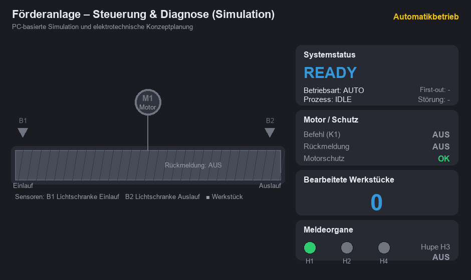
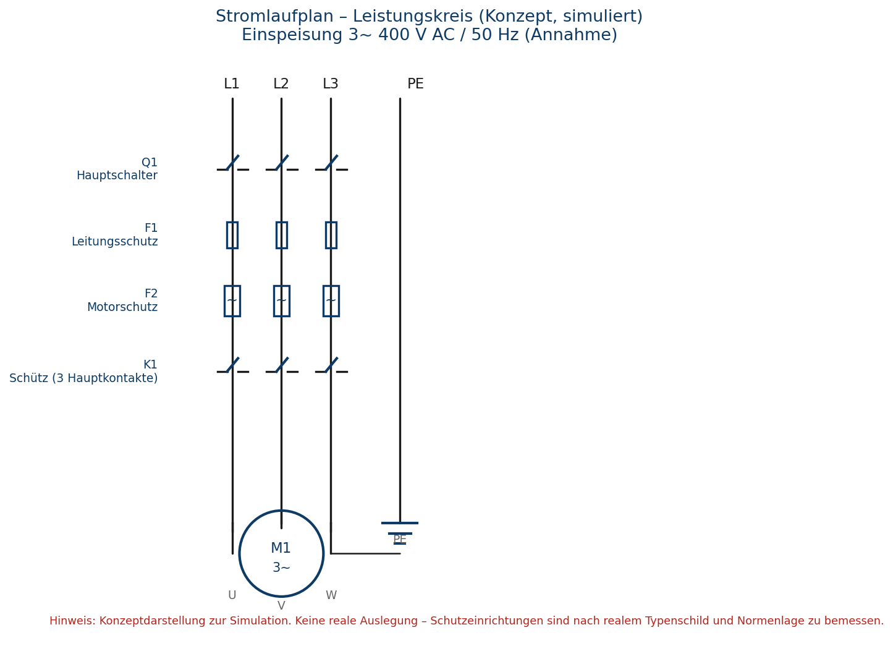
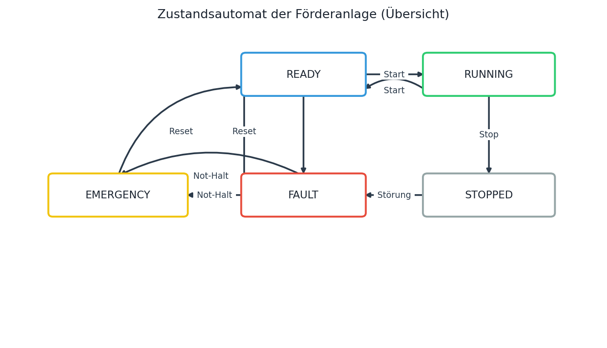
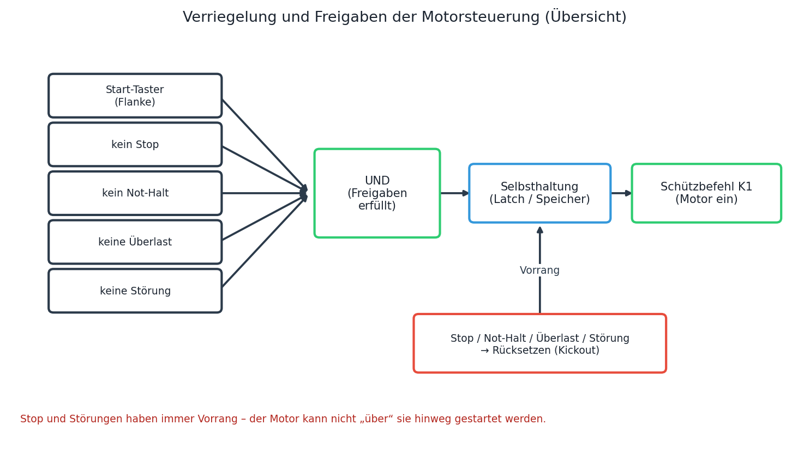
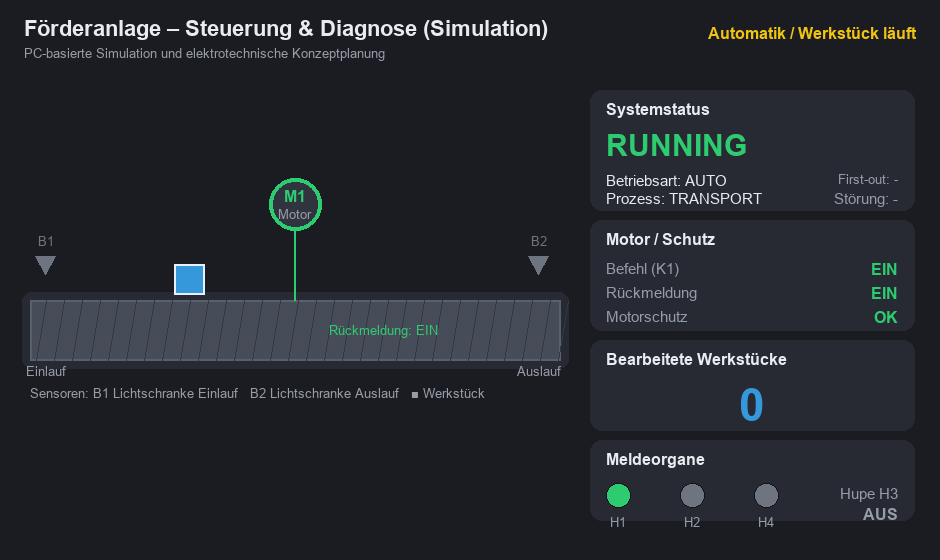

# Automatisierte Förderbandsteuerung mit SPS

Dieses Projekt zeigt die Steuerung einer kleinen Förderanlage über eine SPS
(speicherprogrammierbare Steuerung). Es simuliert den automatischen Ablauf, das
Erkennen und Zählen von Werkstücken, den Motorschutz sowie wichtige
Sicherheitsverriegelungen – entwickelt als PC-basierte Simulation, um
industrielle Steuerungstechnik Schritt für Schritt zu verstehen.

> Eigenes Lernprojekt (Simulation). Es wurde keine reale Anlage gebaut oder
> verdrahtet – alles läuft auf dem PC.



## In einem Satz

Das Projekt ist das „Gehirn“ der Anlage: Es startet und stoppt den Motor, zählt
die Werkstücke auf dem Band, überwacht den Antrieb und schaltet bei einer
Störung sofort sicher ab – mit Lampe und Hupe.

## Feldgeräte und Signale

Die Anlage nutzt typische Signale und Komponenten der Steuerungstechnik:

| Feldgerät / Komponente | Funktion (einfach erklärt) | Signal- / Ansteuerungsart |
|------------------------|----------------------------|---------------------------|
| Drehstrommotor (Förderband) | treibt das Band an | Motorschütz mit Motorschutz |
| Schütz K1 | schaltet den Motorstrom ein/aus | digitaler Ausgang (24 V DC) |
| Motorschutzrelais F2 | schützt den Motor vor Überlast | digitaler Eingang (24 V DC) |
| Lichtschranke Einlauf B1 | erkennt ankommende Werkstücke | digitaler Eingang (24 V DC) |
| Lichtschranke Auslauf B2 | erkennt fertige Werkstücke (Zählung) | digitaler Eingang (24 V DC) |
| Motor-Rückmeldung | meldet, ob der Motor wirklich läuft | digitaler Eingang (24 V DC) |
| Bedienelemente | Taster (Start, Stop, Reset), Not-Halt, Hand/Auto | digitale Eingänge (24 V DC) |
| Melder & Alarm | Leuchten (Grün/Gelb/Rot) und Hupe | digitale Ausgänge (24 V DC) |



## Wie die Steuerung arbeitet

Die SPS arbeitet in einem festen **20-ms-Zyklus** (Hinschauen → Entscheiden →
Handeln):

- **Ablaufsteuerung:** Der Prozess folgt einem klaren Ablauf:
  **BEREIT → START → FÖRDERN → AUSLAUF (ZÄHLEN) → NACHLAUF → STOPP.**
- **Start & Stop:** Der Start schaltet den Motor ein und „hält sich selbst“
  (Selbsthaltung). Ein Druck auf Stop schaltet ihn wieder aus – **Stop hat dabei
  immer Vorrang.**
- **Automatik / Hand:** Im Automatikbetrieb läuft die Anlage selbstständig, sobald
  ein Werkstück am Einlauf ankommt. Im Handbetrieb bedient der Mensch das Band –
  die Sicherheitsregeln bleiben jedoch immer aktiv.



## Sicherheit und Verriegelungen

Feste Regeln verhindern Schäden an Mensch und Maschine:

- **Stop-Vorrang:** Ein Startsignal kann einen Stop nicht übergehen.
- **Not-Halt:** Schaltet den Motor sofort ab und sperrt einen erneuten Start.
- **Überlastschutz:** Löst der Motorschutz aus, stoppt der Motor augenblicklich.
- **Stau-/Blockadeerkennung:** Kommt ein Werkstück nicht rechtzeitig am Auslauf
  an, wird das Band gestoppt und gemeldet.
- **Sensor-Plausibilität:** Meldet der Auslaufsensor dauerhaft ein Werkstück,
  obwohl keines unterwegs ist, wird eine Störung erkannt.

> Hinweis zur Praxis: In einer echten Anlage schaltet ein physisches
> Sicherheitsschaltgerät die Antriebe allpolig ab; im Modell ist diese Logik
> steuerungsseitig nachgebildet.



## Störungen und Meldekonzept

Tritt ein Fehler auf, geht die Anlage in einen sicheren Zustand. Die Störung
wird gespeichert (rote Lampe & Hupe bleiben an), bis die Ursache behoben ist und
manuell **Reset (Quittieren)** gedrückt wird:

- **F01 (Motorüberlast):** Motorschutz hat ausgelöst → Motor aus, Alarm an.
- **F02 (Motor startet nicht):** Befehl ein, aber keine Rückmeldung → Alarm.
- **F03 (Motor stoppt nicht):** Befehl aus, aber Rückmeldung bleibt → Alarm.
- **F04 (Stau):** Werkstück erreicht den Auslauf nicht rechtzeitig.
- **F05 (Sensorfehler):** unplausibles Signal → Sicherheitsstopp.
- **F06 (Not-Halt):** Not-Halt aktiv → sofortiger Stopp.

## Prozessbild (HMI) & Simulation

Eine Bedienoberfläche zeigt den Anlagenzustand in Echtzeit: Band mit
Werkstücken, Sensoren, Motorstatus (Befehl und Rückmeldung), Motorschutz,
Zähler und die aktive Störung. Über Knöpfe lassen sich Start, Stop, Reset,
AUTO/HAND, Not-Halt und auch gezielte Fehler zum Testen bedienen.



Eine Demo zeigt den normalen Ablauf, eine zweite einen absichtlichen Fehler:

- `screenshots/demo.gif` – START → Motor → Werkstück → Auslauf → Zähler → Stop
- `screenshots/fault_demo.gif` – Motor läuft → Überlast → Abschaltung

## Was ich dabei gelernt habe

- **SPS-Programmierung:** Aufbau einer Ablaufsteuerung nach IEC 61131-3
  (Structured Text) und Denken in Zuständen.
- **Signale & Hardware-Denkweise:** Umgang mit 24-V-Schaltsignalen, Schließern
  (NO) und Öffnern (NC) und einer sicheren Rückmeldung.
- **Motorsteuerung:** Warum ein Schütz zum Schalten da ist, wie eine
  Selbsthaltung funktioniert und wie eine Rückmeldung den echten Lauf überwacht.
- **Sicherheitslogik:** Gegenseitige Verriegelungen und ein Fehlerspeicher mit
  Quittierung.
- **Praxis-Transfer:** Das simulierte Logikmodell lässt sich auf reale Steuerungen
  (z. B. CODESYS oder Siemens TIA Portal) und einen Schaltschrank übertragen.

## Ausprobieren

```text
python plc/runtime/run.py --cycles 500 --auto --generate --interactive
python tools/hmi.py            # Live-HMI (Tkinter)
python tests/test_scenarios.py # 30 automatische Tests
```

Die Steuerlogik ist als IEC-61131-3-Structured-Text in `plc/` geschrieben und
wird von einer kleinen, selbst gebauten Python-SoftPLC ausgeführt.

---

**Unterlagen:** [Systembeschreibung](docs/01_Systembeschreibung.md) ·
[Anforderungen](docs/02_Anforderungen.md) ·
[Motorsteuerung](docs/04_Motorsteuerung.md) ·
[Schutz- und Verriegelungskonzept](docs/05_Schutzkonzept.md) ·
[Fehlersuche](docs/07_Fehlersuche.md) ·
[I/O-Liste](electrical/io_list/io_list.md)

Lizenz: MIT
